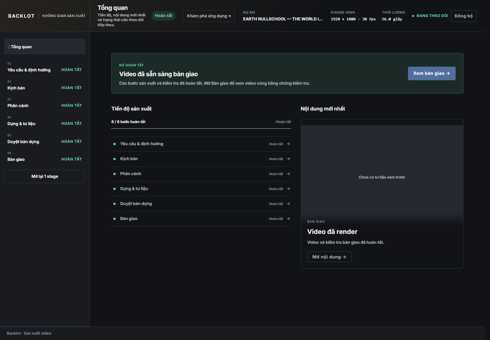
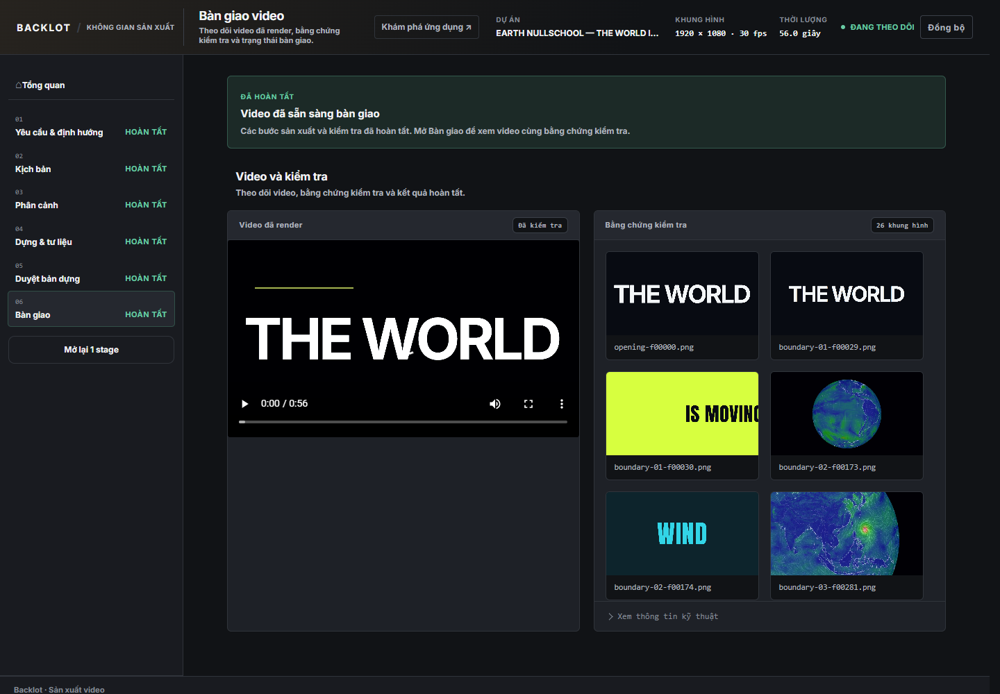
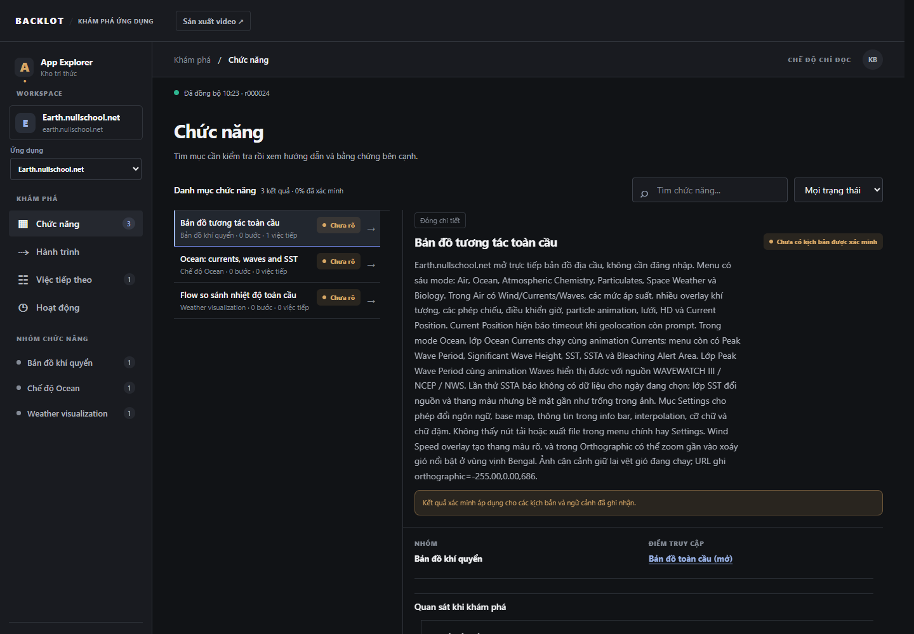

# HTML Video Agent

**Turn your product into a motion ad. Built with your coding agent.**

Create product ads and SaaS promos with kinetic typography, product-centered motion, real interface assets, and optional narration. Shape the campaign with your coding agent, review it in Backlot, and render locally with Remotion or HyperFrames.

[Watch the promo](https://github.com/user-attachments/assets/5ed5537f-2e58-4645-ab3b-3cac6c326db6) · [Quick start](#quick-start) · [Create your first product ad](#create-your-first-product-ad) · [Web dashboard](#web-dashboard) · [Documentation](#documentation)

Bring a product, a target audience, and one message worth remembering. HTML Video Agent gives your coding agent a production workflow to turn that brief into campaign copy, visual beats, assets, animation and an MP4. You review the important decisions in **Backlot** before production moves forward.

The repository manages project state, approvals, assets and rendering. Bring your own coding agent for creative reasoning and authoring.

https://github.com/user-attachments/assets/5ed5537f-2e58-4645-ab3b-3cac6c326db6

**Product promo showcase: Earth Nullschool — The World Is Moving.** A 56-second video built around the product interface, motion and short visual messages, provided here as a 1280 × 720 MP4 with audio. [Open or download the video →](https://github.com/user-attachments/assets/5ed5537f-2e58-4645-ab3b-3cac6c326db6)

> The demo illustrates one completed project. Subject, aspect ratio, length, narration, visual style and renderer are chosen for each new video.

## Built for product ads

- **One campaign message.** Define the audience, objective and dominant product benefit, then develop copy and visual beats around it. Campaigns can aim for awareness, consideration or a clear next action.
- **SaaS and software promos.** Put the interface at the center of the ad with purposeful UI movement, readable type and a recognizable feature payoff.
- **Motion shaped to the brand.** For SaaS ads without a specified style, the product-ad profile favors energetic motion and kinetic typography. Your brief can explicitly choose a calm, minimal or otherwise different direction.
- **Product visuals with provenance.** Use screenshots, recordings and faithfully derived UI elements, with source, rights and scene bindings recorded for production assets.
- **Supported claims.** Ground feature and benefit claims in supplied material or existing product evidence. App Explorer can supply reusable knowledge after you explicitly request exploration.
- **Explore authenticated apps with a human handoff.** With the external agent-browser CLI configured, the agent can open a visible Chrome/Chromium session, let you log in, then continue exploring that same session after you hand control back in chat. It records observations and linked screenshots for later campaign research.
- **Narration and sound.** Add optional local Vietnamese narration and registered audio assets. Review speech, music and effects against the campaign pacing.
- **Review before delivery.** Approve the campaign brief, script, storyboard, assets and visual build through the workflow's review gates.
- **Two rendering engines.** Choose React/TypeScript with Remotion or HTML/CSS with HyperFrames at the Video Brief checkpoint.

The dedicated **product-ad** profile guides campaign attention, product recall and the intended response. The repository also supports product demos, tutorials, explainers, data reports and slide-based videos as secondary use cases.

Every project has one approved semantic source: the script, storyboard and canonical video project. Renderer workspaces implement that approved content. Changing narration or meaning returns to the relevant review step.

## Web dashboard

**Backlot** is the local production dashboard. It shows the current stage, review artifacts, approvals and delivery evidence. Instructions and creative feedback stay in your coding-agent conversation.

### Track production

The overview follows a real completed demo project through request, script, storyboard, production, visual review and delivery.

### Inspect delivery

Review the rendered video and available evidence from the delivery view. Opening a preview and recording approval are separate actions.

### Explore an app

App Explorer is a separate knowledge workspace for explicitly requested app exploration. A URL in a video request does not automatically start browsing or verify product claims.

*These screenshots were captured from the local web interface using the demo project. Interface content and available actions depend on project state.*

## Quick start

### Prerequisites

Install these first:

| Requirement | Used for |
| --- | --- |
| Node.js **22.18+**, including npm | Workflow CLI, dashboard and renderer setup |
| Git | Clone the repository |
| Chrome or Chromium | Local rendering and visual inspection |
| FFmpeg and ffprobe, available on PATH | Media processing and output checks |
| A coding agent with local file, shell and image access | Script, storyboard, assets and renderer authoring |

The repository does not bundle an LLM client or model subscription. Configure your chosen coding agent separately. Asset search, image generation and authenticated app capture depend on the tools and permissions available to that agent.

### Install

~~~bash
git clone https://github.com/toaigiangwpd8y/html-video-agent.git
cd html-video-agent
npm run bootstrap
~~~

Bootstrap installs npm dependencies and both pinned renderer runtimes, installs the renderer guidance, builds the CLI, and verifies both rendering options. It preserves existing project state.

Chrome/Chromium and FFmpeg are separate prerequisites; bootstrap does not download them. If your browser is not discovered, point the readiness check at its executable:

~~~powershell
# Windows PowerShell example — adjust to your installation.
$env:CHROME_PATH = "C:\Program Files\Google\Chrome\Application\chrome.exe"
$env:REMOTION_BROWSER_EXECUTABLE = $env:CHROME_PATH
npm run video -- renderer options --require-all
~~~

On macOS/Linux, set those environment variables using your shell's syntax. On Windows, use npm.cmd if PowerShell blocks npm.ps1.

To repair a renderer installation:

~~~bash
npm run setup -- --renderer=all
npm run build
npm run video -- renderer options --require-all
~~~

### Open Backlot

~~~bash
npm run backlot
~~~

Open **http://127.0.0.1:4200**. Keep this terminal running while you work with your coding agent in another terminal or agent application.

Backlot, renderer previews and project media are served locally. The repository currently implements a local authoring workflow.

## Create your first product ad

### 1. Open the repository in your coding agent

Ask the agent to follow AGENTS.md and use the agent-video skill. For example:

~~~text
Use agent-video with product-ad as the PRIMARY production profile.
Create a 30-second launch ad for my task-management app.

Product material: my supplied screenshots, brand assets and feature notes.
Audience: small teams coordinating client projects.
Campaign objective: encourage viewers to try the product.
Main message: keep project work visible in one shared workspace.
Language: Vietnamese.
Format: 1920 × 1080.
Style: energetic SaaS promo, kinetic type and purposeful UI motion.
Use only features supported by the supplied material.
Propose a short CTA that fits the available product and offer details.
Propose the Video Brief first, then wait for my review in Backlot.
~~~

Supply your product URL, brand assets, screenshots or recordings, supported features, and any offer or CTA details. State the audience, campaign objective, dominant message, placement, language and duration. Reference ads can guide the presentation; your product material supports the claims.

### 2. Review the brief and choose a renderer

The agent assesses the campaign request and asks questions when material information is missing. Review the audience, objective, central message, style and intended response in the Video Brief, then select **Remotion** or **HyperFrames**.

| Renderer | Authoring approach |
| --- | --- |
| Remotion | React/TypeScript compositions, reusable components and frame-based animation |
| HyperFrames | HTML/CSS scenes with the pinned CLI and a local Studio preview |

Your selection is recorded for the project. Renderer availability must pass before the brief is reviewed.

### 3. Approve the script and storyboard

Review the campaign copy, product claims and CTA, then the scene plan. Check that the product remains recognizable and that every beat supports the dominant message. Use **Request Changes** when you want revisions. Approval binds the current artifact, so later changes can require a fresh review.

For narrated work, review the generated speech and measured duration too. If narration exceeds an approved hard limit, the workflow asks for a script or brief decision.

### 4. Review assets and the visual build

After storyboard approval, the agent resolves local assets, records their source and permitted use, and builds the selected renderer workspace. Complete any asset preflight review requested by Backlot.

Open the renderer preview and check UI fidelity, type readability, brand presence, transitions and the product payoff. Review the actual audio and CTA timing. Use Backlot to record the visual decision.

### 5. Render and collect the MP4

After the required approvals, the agent renders and finalizes delivery. Normal completion produces:

~~~text
output/final.mp4
~~~

You can check progress at any time:

~~~bash
npm run video -- status
npm run video -- hitl status
~~~

Backlot records human decisions. The creative agent must stop at a pending review and resume after the host records your approval or change request.

## Optional local narration

For the pinned VieNeu CPU/ONNX narration path, use Python **3.11 or 3.12**:

~~~bash
python -m pip install -r scripts/tts/requirements.txt
npm run video -- tts doctor
~~~

Bootstrap does not install these Python dependencies or model weights. The first synthesis downloads the pinned model snapshots. If you use a virtual environment, activate it first or set VIDEO_TTS_PYTHON to its Python executable.

The narration manifest records exact text, audio hashes and measured duration. Review the voice output as part of your project.

[TTS setup, narration format and duration handling →](docs/TTS.md)

## App Explorer and real interface evidence

Before writing a product ad, you can ask the agent to learn the app's actual features and workflows. App Explorer keeps reusable product knowledge and evidence so the campaign can draw on observed behavior.

### Open Chrome, log in, hand back to the agent

With a compatible external **agent-browser** CLI and Chrome/Chromium configured, the workflow supports a visible browser session shared with you:

1. **Define the scope.** Give the app URL, account role and workflows to explore. Specify which actions the agent may perform, especially actions that create, edit or delete data.
2. **Open the app.** Ask the agent to launch a headed browser session. The browser is the live app surface; Backlot/Explorer shows the knowledge being collected.
3. **Log in yourself.** Complete sign-in, MFA or other interactive steps in the visible browser. Keep credentials in the browser rather than the chat or project files.
4. **Hand control back in chat.** Tell the agent that login is complete and to continue. It checks the account/role and resumes the authorized work on that same browser session.
5. **Explore and record.** The agent inspects controls, performs authorized workflows, observes the results and saves linked evidence. It records unknown or blocked behavior as follow-up work.
6. **Review or resume.** Inspect features, scenarios, questions and evidence in Explorer. Saved knowledge and checkpoints support continuation; an expired login requires you to authenticate again.

For example, give your coding agent this request:

~~~text
Use App Explorer to explore https://my-product.example.
Open a visible Chrome session and let me log in first.
Wait until I say "login complete" before continuing.

Explore the dashboard and the workflow for creating a project.
Use my demo workspace. You may create one clearly labeled test project;
do not delete existing data or change billing or account settings.

After I hand the browser back, continue in the same session.
Capture screenshots of meaningful results and record the steps,
observations, limitations and remaining questions in App Explorer.
We will use supported findings to plan a product ad later.
~~~

The handoff uses a browser session managed by the configured browser tools. Attaching to an existing tab requires a supported session connection; opening an arbitrary personal Chrome tab alone does not register it with App Explorer. The agent-browser CLI is an external prerequisite, configured separately from repository bootstrap.

### What exploration records

- **Features and workflows:** entry points, actions, observed responses, tested context and scenario completion criteria.
- **Screenshots:** a redacted image of an observed result for each exercised UI feature or scenario, linked to the corresponding step and evidence record. This does not require an image for every click.
- **Text/accessibility snapshots:** supporting page structure and control information used to understand the current state.
- **Progress and gaps:** checkpoints, open questions, blocked tasks and the next feasible work, so a pause can be resumed without treating incomplete research as finished.

Evidence images live under the registered app's knowledge workspace in evidence/<run-id>/. Records link them by relative reference. The dataset is versioned separately from the video project and can be reused for later campaigns. Private authentication/session descriptors are kept outside the project and Git; screenshots must be reviewed and redacted before being saved as knowledge.

A screenshot records an observed state. Verified scenarios also need their completion criteria met and the tested context recorded. Login loss, missing evidence or an unresolved result leaves the work partial or blocked.

### Exploration technology

| Component | Role |
| --- | --- |
| Your coding agent + app-explorer skill | Chooses the next authorized task, interprets observations and writes structured knowledge |
| External agent-browser CLI | Drives the live browser, reads accessibility snapshots, interacts with controls and captures screenshots |
| Chrome/Chromium | Runs the actual app and the user-authenticated browser session |
| App Explorer runtime | Stores features, scenarios, evidence references, revisions, checkpoints and follow-up work |
| Backlot/Explorer web interface | Displays collected knowledge, evidence and progress while you steer through chat |
| Pinned playwright-core CDP adapter | Connects production web capture to an explicitly registered shared browser session when that evidence is needed for the ad |

App Explorer's CLI stores and validates knowledge; your coding agent and the external browser CLI perform the exploration. Exploration is explicitly requested and respects the authorized account, role and actions.

To register an app and inspect its knowledge from the CLI:

~~~bash
npm run explore -- apps add --id my-product --name "My Product" --url https://my-product.example
npm run explore -- --app my-product summary --json
npm run explore -- --app my-product next --json
~~~

For a product ad, the agent reads existing knowledge and identifies gaps relevant to the campaign claims. Research evidence becomes a production asset only after the required storyboard, rights, binding and preflight checks.

[Browser workflow and session handoff →](packages/app-explorer/docs/AGENT_BROWSER.md) · [App research contracts →](docs/APP_EXPLORER_RESEARCH.md) · [Web capture guide →](docs/WEB_APP_CAPTURE.md)

## How it works

~~~mermaid
flowchart LR
    A[Product + campaign brief] --> B[Video Brief + renderer choice]
    B --> C[Campaign copy review]
    C --> D[Storyboard review]
    D --> E[Assets + visual implementation]
    E --> F[Preview + human approval]
    F --> G[Render + finalized MP4]
~~~

For advertising, choose product-ad as the primary Production Profile. Its creative criteria prioritize campaign objective, one dominant message, product fidelity and credible claims. The agent writes one complete script and performs a bounded self-check before human review.

Project artifacts remain independent of the renderer:

~~~text
.video/                      Workflow state, brief, script and review records
video.json                   Approved scene meaning, copy and frame budgets
assets/manifest.json         Asset provenance, rights and scene bindings
remotion/generated/          Current Remotion implementation, when selected
hyperframes/projects/        HyperFrames implementation versions, when selected
output/final.mp4              Final video
.video/final-manifest.json   Delivery evidence and output binding
~~~

Project state, generated renderer workspaces, inputs and outputs are git-ignored. A new project can archive previous work; keep deliveries and source media you want to retain.

## Other video formats

The same workflow also supports product demos, tutorials, explainers, pitches, reports and lecture videos. Choose the profile that matches the viewer outcome when these are the main job.

PPTX and PDF input is available for slide-based work through source import and per-slide extraction. See [slide input conventions](video-input/README.md) and the [video-type skills](.agents/skills/video-types/catalog.json) for these secondary workflows.

## Documentation

| Guide | Details |
| --- | --- |
| [Agent instructions](AGENTS.md) | Repository workflow and runtime boundaries |
| [Agent video skill](.agents/skills/agent-video/SKILL.md) | End-to-end authoring procedure |
| [Product ad profile](.agents/skills/video-types/product-ad/SKILL.md) | Campaign objectives, product fidelity and ad presentation guidance |
| [Codex workflow](CODEX_E2E.md) | Checkpoints and authoring flow |
| [Architecture](docs/ARCHITECTURE.md) | Canonical artifacts and renderer ownership |
| [Human review contract](HITL_ADAPTER.md) | Approval and revision states |
| [TTS](docs/TTS.md) | Local narration setup and formats |
| [Web capture](docs/WEB_APP_CAPTURE.md) | Interface capture and asset resolution |

For development checks:

~~~bash
npm run build
npm run verify:host
~~~

## License and attribution

Original project-authored code and documentation use the [MIT License](LICENSE). Third-party components, imported source libraries and rendering runtimes retain their own terms; see [Third-party notices](THIRD_PARTY_NOTICES.md) and [Source notices](SOURCE_NOTICES.md).

The demo includes Earth Nullschool interface imagery. Including a demonstration here does not grant rights to reuse third-party branding, interface imagery or data in another production. Review the sources and intended use for your own assets.

