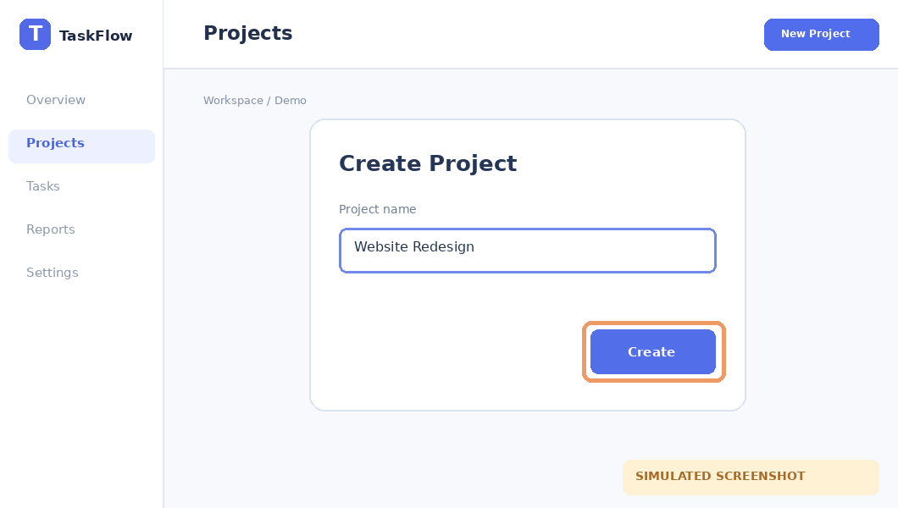
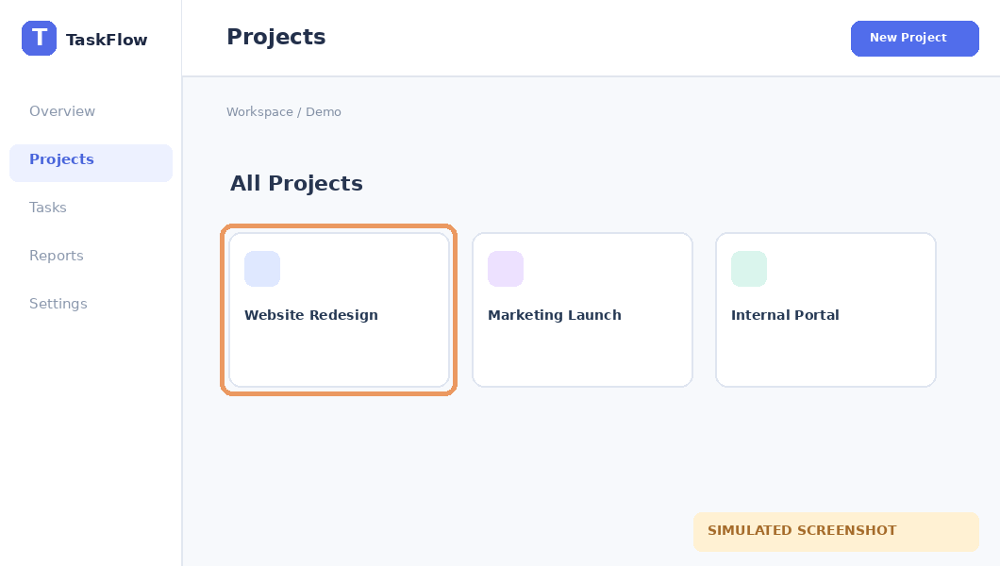

# Tạo dự án

**Area:** Projects · **Status:** verified

Tạo một dự án mới từ màn hình Projects.

**Entry:** Projects → New Project (/projects)

**Last verified:** 2026-10-15

## Walkthrough

### 1. Mở hộp thoại

**Action:** Tại Projects, nhấn New Project.

**Observed:** Hộp thoại Create Project xuất hiện.

[Read snapshot](../../evidence/demo-run/create-dialog.txt)

### 2. Tạo dự án

**Action:** Nhập tên Website Redesign, nhấn Create.

**Observed:** Dự án Website Redesign xuất hiện trong danh sách.

## Next actions

- **Kiểm tra tên dự án trùng** — Chưa rõ ứng dụng xử lý tên trùng như thế nào.

