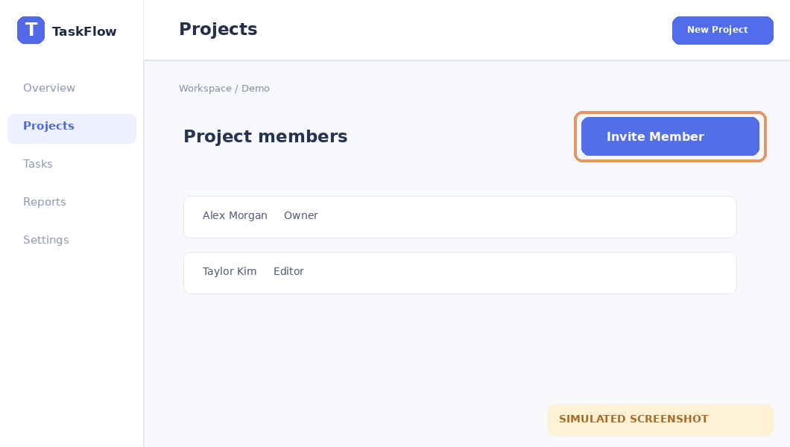

# Mời thành viên

**Area:** Projects · **Status:** partial

Thêm cộng tác viên vào một dự án.

**Entry:** Project → Members (/projects/website-redesign/members)

**Last verified:** Not verified

## Walkthrough

### 1. Mở quản lý thành viên

**Action:** Chọn Members trong dự án.

**Observed:** Nút Invite Member xuất hiện.

## Open questions

- Người có quyền Viewer có thể mời thêm thành viên không?

## Next actions

- **Kiểm tra quyền Viewer** — Chưa xác minh quyền mời thành viên của Viewer.

