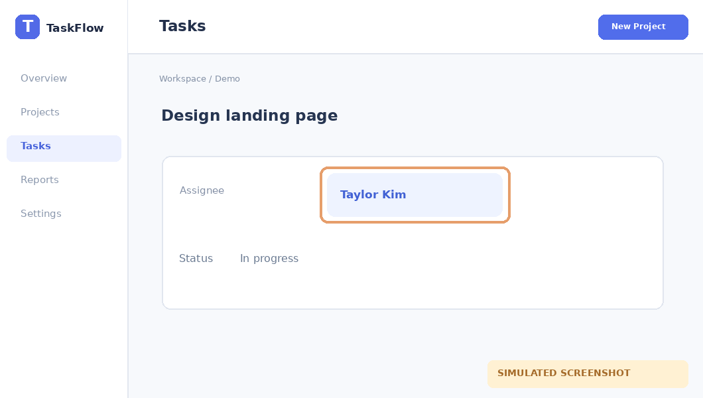

# Phân công công việc

**Area:** Tasks · **Status:** verified

Gán người phụ trách cho một công việc.

**Entry:** Tasks → Open task (/tasks)

**Last verified:** 2026-10-15

## Walkthrough

### 1. Chọn người phụ trách

**Action:** Mở task và chọn Assignee.

**Observed:** Tên người phụ trách hiển thị trên task sau khi chọn.

