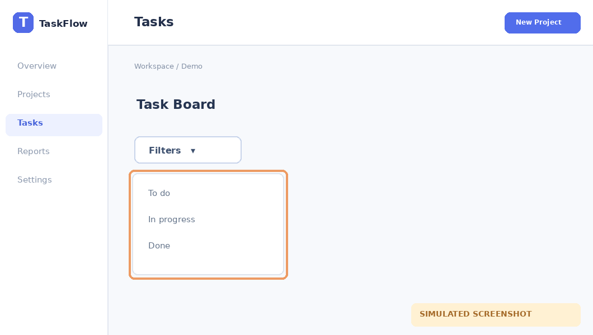

# Lọc công việc

**Area:** Tasks · **Status:** partial

Lọc danh sách công việc theo trạng thái.

**Entry:** Tasks → Filters (/tasks)

**Last verified:** Not verified

## Walkthrough

### 1. Mở bộ lọc

**Action:** Nhấn Filters.

**Observed:** Menu trạng thái hiện ra.

## Next actions

- **Xác minh danh sách sau khi lọc** — Mới quan sát menu, chưa kiểm tra dữ liệu trả về.

